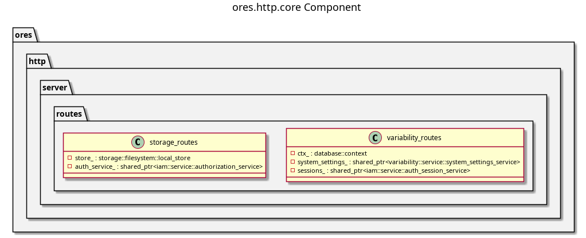

:PROPERTIES:
:ID: 869526B6-6C82-430E-95E1-776D4A11A56B
:END:
#+title: ores.http.core
#+name: http.core
#+full_name: ores.http.core
#+description: HTTP route implementations for the ORE Studio REST API — IAM, storage, and variability routes.
#+brief: REST API HTTP route implementations
#+type: ores.codegen.component
#+component_kind: core
#+hidden_visibility: true
#+level: cross
#+filetags: :http:core:component:
#+created: 2026-05-19
#+updated: 2026-05-19

* Diagram

#+attr_html: :width 100% :alt ores.http.core component diagram
#+caption: ores.http.core

* Summary

=ores.http.core= implements the concrete HTTP route handlers for the ORE Studio
REST API. It registers routes for each domain it still owns in process:
storage and variability (configuration). The domain components served through
generated NATS-forwarding route units live in their own adapter parts under
=projects/ores.http/= — =ores.http.iam=, =ores.http.assets= and
=ores.http.refdata=. Each route handler translates the incoming HTTP request
into NATS calls to the appropriate domain service and returns the NATS
response as an HTTP response.

* Inputs

- Incoming HTTP requests dispatched from =ores.http.api= router.
- NATS responses from =ores.iam.service=, =ores.variability.service=,
  =ores.storage.service=, etc.

* Outputs

- HTTP responses constructed from NATS domain service responses.
- Route registrations added to the =ores.http.api= router and OpenAPI registry.

* Entry points

- =include/ores.http.core/routes/variability_routes.hpp= — config handlers.
- =include/ores.http.core/routes/storage_routes.hpp= — storage handlers.

* Dependencies

- =ores.http.api= — server infrastructure, router, JWT claims.
- =ores.iam.api=, =ores.variability.api=, =ores.storage.api=
  — NATS protocol types for each domain service called.
- =nats.c= — NATS client for forwarding requests.

* Build dependencies

What the shared profile cannot know, declared here rather than
hand-edited into the generated build file. Each block is spliced
into its generated file after the profile's baseline.

* See also

- [[id:B0C9FDC8-F0B2-48FE-AE37-8FD79E6FD164][ores.http.api]] — server infrastructure this library builds on.
- [[id:A8B318BC-8653-4D33-A58C-60793E3596D5][ores.http.server]] — server entrypoint that wires these routes.

#+begin_src cmake :name extra_dependencies
target_link_libraries(${lib_target_name}
    PUBLIC
        ores.storage.core.lib
        ores.http.api.lib
        ores.iam.core.lib
        ores.variability.core.lib
        ores.compute.core.lib
        ores.geo.lib
    PRIVATE
        ores.utility.lib
        ores.security.lib
        ores.database.lib
        ores.dq.api.lib)
#+end_src
