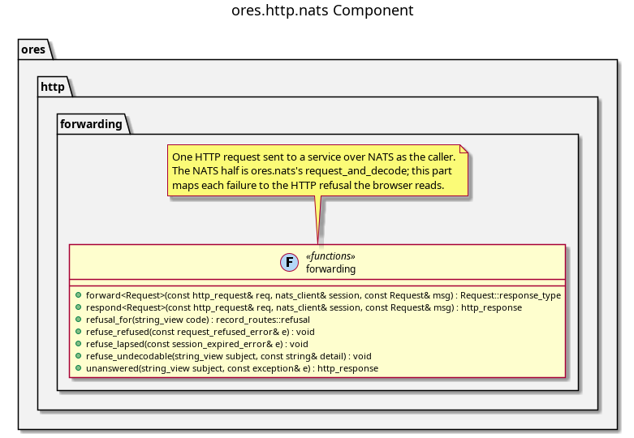

:PROPERTIES:
:ID: AC038FDD-D042-47C4-8759-21E3E0236DD7
:END:
#+title: ores.http.nats
#+description: The HTTP gateway's forwarding step: one HTTP request sent to a service over NATS as the caller, and each failure stated as an HTTP refusal.
#+type: ores.codegen.component
#+component_kind: core
#+level: cross
#+filetags: :http:rest:nats:component:
#+created: 2026-11-11
#+updated: 2026-11-11
#+name: nats
#+full_name: ores.http.nats
#+brief: HTTP gateway forwarding over NATS

* Diagram

#+attr_html: :width 100% :alt ores.http.nats component diagram
#+caption: ores.http.nats

* Summary

=ores.http.nats= is the gateway's forwarding step, shared by every route unit
that sends a request to a service. It sits between =ores.http.api=, which is
the HTTP framework and does not depend on NATS, and =ores.nats=, which owns the
transport. A client of the HTTP API therefore does not pull NATS in.

The NATS half of the step is =ores.nats='s own: =request_and_decode= sends a
canonical request on its subject and decodes the reply, raising a service
refusal as =request_refused_error= and a lapsed session as
=session_expired_error=. This part adds only what the HTTP surface owns. It
delegates the caller's token, so the service checks that caller's permission,
and it states each failure as the HTTP refusal the browser reads, through one
table.

| Failure | Status | Code |
|---------+--------+------|
| refusal =forbidden= | 403 | =forbidden= |
| refusal =bad_request= | 400 | =invalid-request= |
| refusal =unauthorized= | 401 | =not-authenticated= |
| any other refusal | 502 | =upstream-unavailable= |
| a session the service could not renew | 401 | =session-expired= |
| a reply that does not decode | 502 | =internal= |
| a transport failure | 502 | =internal= |

A failure that is not the caller's to act on is logged with its detail, and
the body states a fixed sentence.

The part declares =#+component_kind: adapter=. Its =CMakeLists.txt= files are
hand-authored, and codegen writes only the two =component_files.cmake= lists.

* Inputs

- The HTTP request, for the caller's bearer token.
- The connected NATS client the route units hold.
- A canonical request, which names its own subject and response type.

* Outputs

- The decoded response, from =forward=, or the response as JSON, from =respond=.
- A =record_routes::refusal= for each failure the table names.

* Entry points

- =include/ores.http.nats/forwarding.hpp= -- =forward=, =respond= and =refusal_for=.

* Dependencies

- =ores.http.api= -- the request, the response and the record route refusal.
- =ores.nats= -- the typed request and its errors.
- =ores.utility= -- the wire codecs.
- =ores.logging= -- logger factory.

* See also

- [[id:A8B318BC-8653-4D33-A58C-60793E3596D5][ores.http.server]] -- the process that hosts the routes.
- [[id:1EBDA080-07F6-496D-AA4A-72899E65641C][ores.cpp.http-route]] -- the facet whose units forward through this part.
- [[id:F27E5DF7-6223-4B6F-80A5-CEFBEB1BC756][Component architecture]] -- the composite and adapter kinds.

#+begin_src cmake :name extra_dependencies
target_link_libraries(${lib_target_name}
    PUBLIC
        ores.http.api.lib
        ores.nats.lib
        ores.logging.lib
    PRIVATE
        ores.utility.lib)
#+end_src

#+begin_src cmake :name extra_test_dependencies
target_link_libraries(${tests_target_name}
    PRIVATE
        ${lib_target_name}
        ores.testing.lib
        Catch2::Catch2
        ores.openssl_cleanup
        Threads::Threads)
#+end_src
