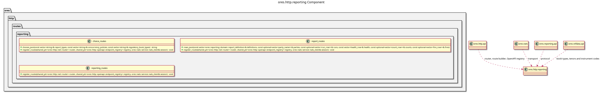

:PROPERTIES:
:ID: 94D94398-6DFC-414C-B139-BB01C297805D
:END:
#+title: ores.http.reporting
#+description: The HTTP gateway's reporting adapter part. Holds the route units that project the reporting and analytics domains onto the REST surface.
#+type: ores.codegen.component
#+component_kind: adapter
#+level: cross
#+filetags: :http:rest:reporting:component:
#+created: 2026-11-13
#+updated: 2026-11-13
#+name: reporting
#+full_name: ores.http.reporting
#+brief: HTTP reporting route units

* Diagram

#+attr_html: :width 100% :alt ores.http.reporting component diagram
#+caption: ores.http.reporting

* Summary

=ores.http.reporting= is the adapter part that projects the reporting domain
onto the HTTP server's REST surface. It holds the units the reporting screens
call at the addresses the BFF answered: the codes a report's edit form offers,
the report definitions and the runs they raise, one run's page and the problems
it recorded.

The area's remaining families -- the cuts, the schedule writes, the ORE value
sets with the engine settings and the pricing engines, and a run's files and
results -- are designed one at a time before they are served, and the task that
owns them records each design.

The units speak the canonical protocol over NATS and hold no service,
repository or database context: the reporting, analytics and reference data
services stay the only places that decide, and the caller's own token travels
with every forwarded request.

The part declares =#+component_kind: adapter=. Its =CMakeLists.txt= files are
hand-authored, because the link libraries belong to the HTTP surface rather
than to the domain, and codegen writes only the two =component_files.cmake=
lists. A regeneration therefore never writes over the build.

The units answer under the =reporting= area of the route inventory.

* Inputs

- HTTP requests on the reporting screens' paths the units register.
- The caller's bearer token, forwarded to the service on every NATS request.
- The connected NATS client the hand-written aggregate passes to
  =register_routes=.

* Outputs

- The routes and their OpenAPI schemas, registered on the router and the
  endpoint registry.
- NATS request messages to the reporting, analytics and reference data
  services, one or more per route.

* Entry points

- =include/ores.http/routes/reporting/= -- the unit headers.
- =src/routes/reporting/= -- the unit implementations.
- =reporting_routes= -- the aggregate the host calls to install every unit.

* Dependencies

- =ores.http.api= -- the router, the route builder, the OpenAPI registry and
  the request/response types.
- =ores.http.nats= -- the gateway's one forwarding step to the services.
- =ores.nats= -- NATS transport for service calls.
- =ores.reporting.api= -- the canonical protocol messages of the reporting
  service.
- =ores.refdata.api= -- the book types, tenors and instrument codes the forms
  choose from.
- =ores.iam.api= -- the parties the caller's own account works in, which a
  screen names by the party's name and never its id.
- =ores.compute.api= -- the batch that ran a report, which the run's page names.
- =ores.utility= -- the codecs and the wire support types.
- =ores.logging= -- the logger factory the part's tests log through.

* See also

- [[id:A8B318BC-8653-4D33-A58C-60793E3596D5][ores.http.server]] -- the process that hosts these routes.
- [[id:F27E5DF7-6223-4B6F-80A5-CEFBEB1BC756][Component architecture]] -- the composite and adapter kinds.
- [[id:544947D0-7E23-4145-8F62-EC8341ED42FF][ores.reporting.service]] -- the service that owns the reports, the cuts and the engine settings.
- [[id:E5952F27-53BD-4C4D-85CD-556B6421B768][ores.analytics.service]] -- the service that owns the pricing models and engines.

#+begin_src cmake :name extra_dependencies
target_link_libraries(${lib_target_name}
    PUBLIC
        ores.http.api.lib
        ores.nats.lib
        ores.logging.lib
        ores.reporting.api.lib
        ores.refdata.api.lib
        ores.iam.api.lib
        ores.compute.api.lib
    PRIVATE
        ores.http.nats.lib
        ores.utility.lib)
#+end_src

#+begin_src cmake :name extra_test_dependencies
target_link_libraries(${tests_target_name}
    PRIVATE
        ${lib_target_name}
        ores.testing.lib
        Catch2::Catch2
        ores.openssl_cleanup
        Threads::Threads)
#+end_src
