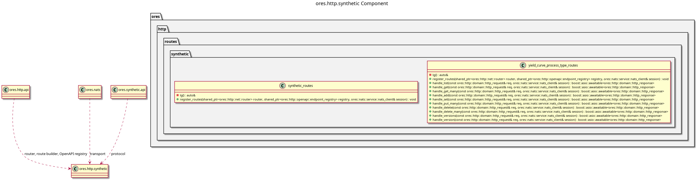

:PROPERTIES:
:ID: B8376009-B47E-4B2F-ADD8-AD6B79D1A7AC
:END:
#+title: ores.http.synthetic
#+description: The HTTP gateway's synthetic adapter part. Holds the generated route units that project the synthetic domain onto the REST surface.
#+type: ores.codegen.component
#+component_kind: adapter
#+level: cross
#+filetags: :http:rest:synthetic:component:
#+created: 2026-11-07
#+updated: 2026-11-07
#+name: synthetic
#+full_name: ores.http.synthetic
#+brief: HTTP synthetic route units

* Diagram

#+attr_html: :width 100% :alt ores.http.synthetic component diagram
#+caption: ores.http.synthetic

* Summary

=ores.http.synthetic= is the adapter part that projects the synthetic domain
onto the HTTP server's REST surface. It holds the generated route units for
the synthetic models that opt in, and each unit owns one route per derived
verb.

Synthetic's models opt in through the =:ores.cpp.http-route.enabled:= property
in their own model drawer, so a model that needs no route can leave the facet
off. The units speak the canonical protocol over NATS and hold no service,
repository or database context: the synthetic service stays the only place
that decides, and the caller's own token travels with every forwarded request.

The part declares =#+component_kind: adapter=. Its =CMakeLists.txt= files are
hand-authored, because the link libraries belong to the HTTP surface rather
than to the domain, and codegen writes only the two =component_files.cmake=
lists. A regeneration therefore never writes over the build.

The units are output of the =ores.cpp.http-route= facet, which is opt-in per
model. The facet writes here because the part is named after the domain the
units project, which is the fractal naming rule in
[[id:F27E5DF7-6223-4B6F-80A5-CEFBEB1BC756][Component architecture]].

The units answer under the =simulation= area, which
=#+http_area:= states on each model rather than the part stating it once,
because the area is a published namespace and not a property of the component
that happens to hold the model.

* Inputs

- HTTP requests on the =/api/v1/simulation/...= paths the units register.
- The caller's bearer token, forwarded to the service on every NATS request.
- The connected NATS client the hand-written per-component aggregator passes
  to =register_routes=.
- The synthetic models under =projects/ores.synthetic/modeling/= whose drawers
  opt in to the =ores.cpp.http-route= facet.

* Outputs

- One route unit per opted-in model, at
  =src/routes/synthetic/<unit>_routes.cpp= and
  =include/ores.http/routes/synthetic/<unit>_routes.hpp=.
- The routes and their OpenAPI schemas, registered on the router and the
  endpoint registry.
- NATS request messages to the synthetic service, one per route.

* Entry points

- =include/ores.http/routes/synthetic/= -- the generated unit headers.
- =src/routes/synthetic/= -- the generated unit implementations.
- =yield_curve_process_type_routes= -- the unit-level entry the host calls to
  install the process types' routes.

* Dependencies

- =ores.http.api= -- the router, the route builder, the OpenAPI registry and
- =ores.http.nats= -- the gateway's one forwarding step to the services.
  the request/response types.
- =ores.nats= -- NATS transport for service calls.
- =ores.synthetic.api= -- the canonical protocol messages the units send.
- =ores.utility= -- the codecs and the wire support types.
- =ores.logging= -- logger factory.

* See also

- [[id:A8B318BC-8653-4D33-A58C-60793E3596D5][ores.http.server]] -- the process that hosts these routes.
- [[id:1EBDA080-07F6-496D-AA4A-72899E65641C][ores.cpp.http-route]] -- the facet that emits the units.
- [[id:F27E5DF7-6223-4B6F-80A5-CEFBEB1BC756][Component architecture]] -- the composite and adapter kinds.
- [[id:96AB808A-DF49-410F-8A90-D1065A3716AC][ores.synthetic]] -- the domain this part projects.

#+begin_src cmake :name extra_dependencies
target_link_libraries(${lib_target_name}
    PUBLIC
        ores.http.api.lib
        ores.nats.lib
        ores.logging.lib
    PRIVATE
        ores.http.nats.lib
        ores.synthetic.api.lib
        ores.utility.lib)
#+end_src

#+begin_src cmake :name extra_test_dependencies
target_link_libraries(${tests_target_name}
    PRIVATE
        ${lib_target_name}
        ores.testing.lib
        Catch2::Catch2
        ores.openssl_cleanup
        Threads::Threads)
#+end_src
