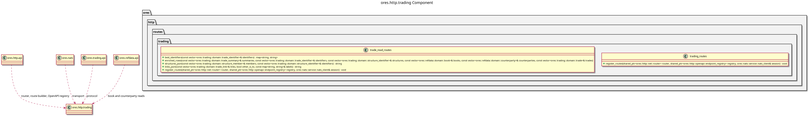

:PROPERTIES:
:ID: 486707D5-F459-4C97-95EA-A6C0D7F7043D
:END:
#+title: ores.http.trading
#+description: The HTTP gateway's trading adapter part. Holds the route units that project the trading domain onto the REST surface.
#+type: ores.codegen.component
#+component_kind: adapter
#+level: cross
#+filetags: :http:rest:trading:component:
#+created: 2026-11-12
#+updated: 2026-11-12
#+name: trading
#+full_name: ores.http.trading
#+brief: HTTP trading route units

* Diagram

#+attr_html: :width 100% :alt ores.http.trading component diagram
#+caption: ores.http.trading

* Summary

=ores.http.trading= is the adapter part that projects the trading domain onto
the HTTP server's REST surface. It holds the units the trading screens call at
the addresses the BFF answered: trades and their versions, booking, structures
and their legs, and the book writes and book changes.

The units speak the canonical protocol over NATS and hold no service,
repository or database context: the trading service stays the only place that
decides, and the caller's own token travels with every forwarded request.

The part declares =#+component_kind: adapter=. Its =CMakeLists.txt= files are
hand-authored, because the link libraries belong to the HTTP surface rather
than to the domain, and codegen writes only the two =component_files.cmake=
lists. A regeneration therefore never writes over the build.

The units answer under the =trading= area of the route inventory.

* Inputs

- HTTP requests on the trading screens' paths the units register.
- The caller's bearer token, forwarded to the service on every NATS request.
- The connected NATS client the hand-written aggregate passes to
  =register_routes=.

* Outputs

- The routes and their OpenAPI schemas, registered on the router and the
  endpoint registry.
- NATS request messages to the trading service, one or more per route.

* Entry points

- =include/ores.http/routes/trading/= -- the unit headers.
- =src/routes/trading/= -- the unit implementations.
- =trading_routes= -- the aggregate the host calls to install every unit.

* Dependencies

- =ores.http.api= -- the router, the route builder, the OpenAPI registry and
  the request/response types.
- =ores.http.nats= -- the gateway's one forwarding step to the services.
- =ores.nats= -- NATS transport for service calls.
- =ores.trading.api= -- the canonical protocol messages the units send.
- =ores.refdata.api= -- the book and counterparty reads that name a trade's rows.
- =ores.utility= -- the codecs and the wire support types.
- =ores.logging= -- logger factory.

* See also

- [[id:A8B318BC-8653-4D33-A58C-60793E3596D5][ores.http.server]] -- the process that hosts these routes.
- [[id:1EBDA080-07F6-496D-AA4A-72899E65641C][ores.cpp.http-route]] -- the facet that emits the units.
- [[id:F27E5DF7-6223-4B6F-80A5-CEFBEB1BC756][Component architecture]] -- the composite and adapter kinds.
- [[id:5C7A961E-D834-4B2F-AE15-F049B27361D8][ores.trading]] -- the domain this part projects.

#+begin_src cmake :name extra_dependencies
target_link_libraries(${lib_target_name}
    PUBLIC
        ores.http.api.lib
        ores.nats.lib
        ores.logging.lib
        ores.trading.api.lib
        ores.refdata.api.lib
        ores.iam.api.lib
    PRIVATE
        ores.http.nats.lib
        ores.utility.lib)
#+end_src

#+begin_src cmake :name extra_test_dependencies
target_link_libraries(${tests_target_name}
    PRIVATE
        ${lib_target_name}
        ores.testing.lib
        Catch2::Catch2
        ores.openssl_cleanup
        Threads::Threads)
#+end_src
