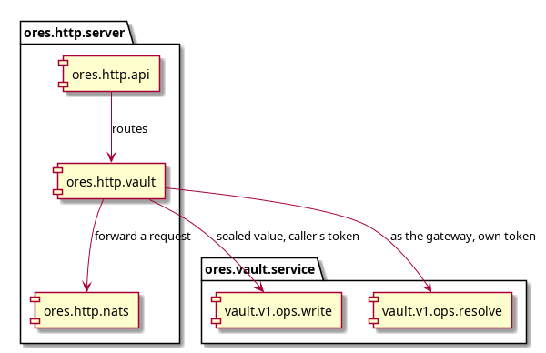

:PROPERTIES:
:ID: 8E2B41C7-D3A5-4F60-9C18-5B7E4D21A9F3
:END:
#+title: ores.http.vault
#+description: The HTTP gateway's vault adapter part. Holds the two hand-written routes a person uses: a write that seals in the gateway, and a reveal that answers over the session.
#+type: ores.codegen.component
#+component_kind: adapter
#+level: cross
#+filetags: :http:rest:vault:component:
#+created: 2026-11-26
+#+updated: 2026-11-26
#+name: vault
#+full_name: ores.http.vault
#+brief: HTTP vault route units

* Diagram

#+attr_html: :width 100% :alt ores.http.vault component diagram
#+caption: ores.http.vault

* Summary

=ores.http.vault= is the adapter part that projects custody onto the HTTP
server's REST surface. Its routes are hand-written and not generated, because
neither of them forwards a body unchanged: the write seals the value to the
vault's transport key before it leaves this process, and the reveal opens a
reply the vault sealed to this process's own key and answers it over the
person's session.

A person therefore never holds a key and never needs one. The gateway is a
consumer of the vault in its own right: it registers its public half, resolves
as itself, and records the person in its own log.

* Inputs

- A secret's name, its owning consumer and its value, from a person holding the
  write.
- The name of a secret to reveal, from a person holding the read.

* Outputs

- The acknowledgement of a write: the name and the key version.
- The value, on the reveal route only, with =Cache-Control: no-store=.

* Entry points

- =include/ores.http/routes/vault/vault_routes.hpp= — the two routes.
- =build/keys/gateway.transport.key= — the credential the reveal opens with,
  placed by the deployment and never named by configuration.

* Dependencies

- =ores.http.api=, =ores.http.nats=, =ores.nats=, the request and the forward.
- =ores.vault.api= — the custody protocol.
- =ores.security= — the sealed box, on both sides of the hop.

* See also

- [[id:4F28F755-7DA1-4EDD-9983-256622B6088A][Sealed Delivery of a Secret to Its
  Consumer]] — the mechanism these routes put a person in front of.

#+begin_src cmake :name extra_dependencies
target_link_libraries(${lib_target_name}
    PUBLIC
        ores.http.api.lib
        ores.http.nats.lib
        ores.logging.lib
        ores.nats.lib
        ores.vault.api.lib
    PRIVATE
        Boost::json
        ores.security.lib
        ores.utility.lib)
#+end_src

#+begin_src cmake :name extra_test_dependencies
target_link_libraries(${tests_target_name}
    PRIVATE
        ${lib_target_name}
        ores.testing.lib
        Catch2::Catch2
        Catch2::Catch2WithMain)
#+end_src
