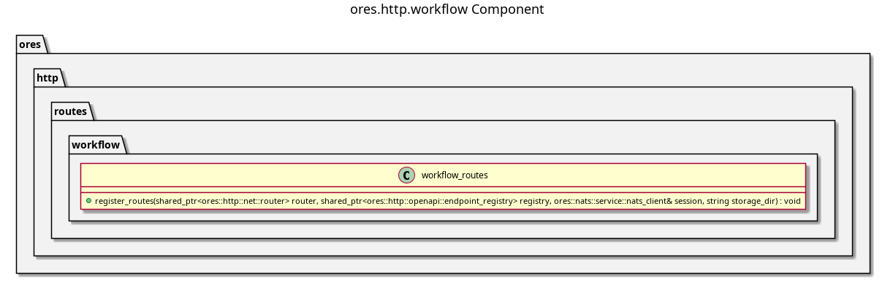

:PROPERTIES:
:ID: 2ACD2D6E-C6E5-4C5D-BBEE-3D3E67C2CC46
:END:
#+title: ores.http.workflow
#+description: The HTTP gateway's workflow adapter part. Holds the route units that project the request inbox, the workflow engine and the operations roster onto the REST surface.
#+type: ores.codegen.component
#+component_kind: adapter
#+level: cross
#+filetags: :http:rest:workflow:component:
#+created: 2026-11-17
#+updated: 2026-11-17
#+name: workflow
#+full_name: ores.http.workflow
#+brief: HTTP workflow and operations route units

* Diagram

#+attr_html: :width 100% :alt ores.http.workflow component diagram
#+caption: ores.http.workflow

* Summary

=ores.http.workflow= is the adapter part that projects the request inbox, the
workflow engine and the operations roster onto the HTTP server's REST surface.
It serves the workflow screens: the requests a person raises, withdraws and
decides, the notices they are given, the retry of a stopped run, and the
services and logs an operator reads.

The units speak the canonical protocol over NATS and hold no service,
repository or database context: the inbox and the engine stay the only places
that decide, and the caller's own token travels with every forwarded request.

The part declares =#+component_kind: adapter=. Its =CMakeLists.txt= files are
hand-authored, because the link libraries belong to the HTTP surface rather than
to the domain, and codegen writes only the two =component_files.cmake= lists.

The units answer under the =workflow= and =operations= areas, which
=#+http_area:= states on each model rather than the part stating it once,
because the area is a published namespace and not a property of the component
that happens to hold the model.

* Inputs

- HTTP requests on the =/api/me/requests=, =/api/requests=, =/api/me/notifications=,
  =/api/workflow= and =/api/operations= paths the units register.
- The caller's bearer token, forwarded to the service on every NATS request.
- The connected NATS client the per-component aggregator passes to
  =register_routes=.

* Outputs

- One route unit per workflow resource, at
  =src/routes/workflow/<unit>_routes.cpp= and
  =include/ores.http/routes/workflow/<unit>_routes.hpp=.
- The routes and their OpenAPI schemas, registered on the router and the
  endpoint registry.
- NATS request messages to the inbox, workflow and telemetry services, one per
  route.

* Entry points

- =include/ores.http/routes/workflow/= -- the unit headers.
- =src/routes/workflow/= -- the unit implementations.
- =workflow_routes= -- the aggregate the server calls to install the part's
  routes.

* Dependencies

- =ores.http.api= -- the router, the route builder, the OpenAPI registry and
  the request/response types.
- =ores.http.nats= -- the gateway's one forwarding step to the services.
- =ores.nats= -- NATS transport for service calls.
- =ores.inbox.api= -- the canonical protocol messages about a request and the
  notices a person is given.
- =ores.workflow.api= -- the canonical protocol messages about a run.
- =ores.utility= -- the codecs and the wire support types.
- =ores.logging= -- logger factory.

* See also

- [[id:A8B318BC-8653-4D33-A58C-60793E3596D5][ores.http.server]] -- the process that hosts these routes.
- [[id:09BD5681-9C12-469A-80DA-27D1DF9D0808][ores.http]] -- the composite that holds the parts.

#+begin_src cmake :name extra_dependencies
target_link_libraries(${lib_target_name}
    PUBLIC
        ores.http.api.lib
        ores.nats.lib
        ores.logging.lib
        ores.inbox.api.lib
        ores.iam.api.lib
        ores.workflow.api.lib
    PRIVATE
        ores.http.nats.lib
        ores.utility.lib)
#+end_src

#+begin_src cmake :name extra_test_dependencies
target_link_libraries(${tests_target_name}
    PRIVATE
        ${lib_target_name}
        ores.testing.lib
        Catch2::Catch2
        ores.openssl_cleanup
        Threads::Threads)
#+end_src
