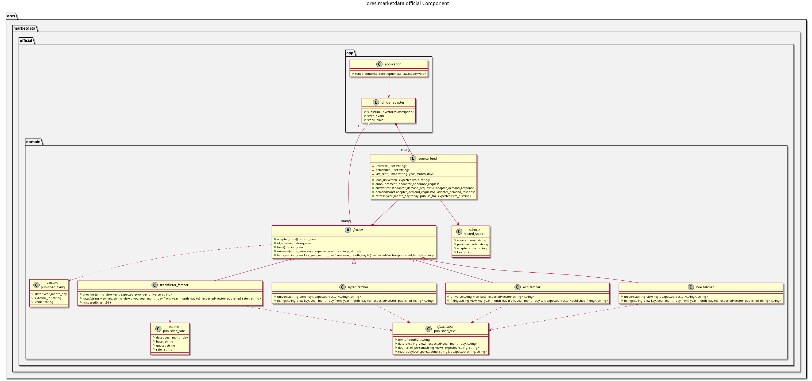

:PROPERTIES:
:ID: 6CC4B925-BFE1-4F84-81D0-56D2F3DE986A
:ores.cpp.service-app.enabled: nil
:END:
#+title: ores.marketdata.official
#+description: The official rates adapter: fetches what central banks and public bodies publish and sends it as fixing ticks.
#+type: ores.codegen.component
#+component_kind: service
#+level: cross
#+filetags: :marketdata:official:adapter:component:
#+created: 2026-10-28
#+updated: 2026-10-28
#+name: marketdata.official
#+full_name: ores.marketdata.official
#+brief: Official rates adapter

* Diagram

#+attr_html: :width 100% :alt ores.marketdata.public component diagram
#+caption: ores.marketdata.official

* Summary

=ores.marketdata.official= hosts the adapters for official market data: the daily rates
that central banks and other public bodies publish. Each adapter reads one access route
through a fetcher of its own, and the process shares the rest between them. It speaks the adapter contract of the
market data service, as the simulator does: it announces each source it hosts with the
ids its publisher publishes, answers the demand set the service sends, sends a
heartbeat, and publishes each fixing as a tick in the publisher's own notation. On a new
demand it backfills a window, oldest first, and after that it asks each publisher once a
day. The Frankfurter adapter reads the publishers through Frankfurter, one provider at a
time. Each fetcher reads over =ores.http.client=, and the process needs no database: the
service maps and stores what it sends.

* Inputs

- Its configuration: the Frankfurter address, the sources it hosts with the provider and
  the adapter of each, the backfill window and the minutes between two polls.
- The demand set of each source, from the market data service.
- The answers of each publisher's access route, such as Frankfurter.

* Outputs

- An announce and a heartbeat for each source.
- An =adapter_tick= for each fixing of a demanded vendor id, on the source's ingress
  subject.

* Entry points

- =ores.marketdata.official=, the process.
- =fetcher=, the specialised half of an adapter: its code, its notation, and how it reads
  its publisher.
- =frankfurter_fetcher=, the fetcher that reads one Frankfurter provider's universe and
  rates.
- =nyfed_fetcher=, the fetcher that reads a reference rate of the New York Fed, such as
  SOFR, and stores the decimal of its published percent.
- =ecb_fetcher=, the fetcher that reads a series of the ECB Data Portal, such as €STR, and
  asks again when the portal's gateway times out.
- =boe_fetcher=, the fetcher that reads a series of the Bank of England's statistical
  database, such as SONIA.
- =boc_fetcher=, the fetcher that reads a series of the Bank of Canada's Valet API, such as
  CORRA.
- =boj_fetcher=, the fetcher that reads a series of the Bank of Japan's time-series API, such
  as the uncollateralised overnight call rate.
- =norges_bank_fetcher=, the fetcher that reads a series of Norges Bank's SDMX API, such as NOWA.
- =riksbank_fetcher=, the fetcher that reads a series of the Riksbank's SWESTR API, such as SWESTR.
- =rba_fetcher=, the fetcher that reads a series of an RBA statistical table, such as AONIA.
- =bcb_fetcher=, the fetcher that reads a series of the Banco Central do Brasil's SGS API, such as the annualised CDI.
- =published_text=, the date, number and HTTP helpers that every fetcher shares.
- =source_feed=, which serves one source through its fetcher.
- =official_adapter=, which hosts every source and gives each the fetcher of its adapter.

* Dependencies

- =ores.marketdata.api= for the adapter contract.
- =ores.http.client= for HTTPS.
- =ores.nats= for the bus.

* See also

- [[id:F4BBEF34-D84C-4AE6-A3AA-DC47C3EE06EE][Public sources publish daily fixings through an adapter]] -- the design.

* Build dependencies

What the shared profile cannot know, declared here rather than hand-edited into the
generated build file. Each block is spliced into its generated file after the profile's
baseline.

#+begin_src cmake :name extra_dependencies
find_package(Boost REQUIRED COMPONENTS json program_options)

target_link_libraries(${lib_target_name}
    PUBLIC
        ores.marketdata.api.lib
        ores.http.client.lib
        ores.nats.lib
        ores.service.lib
        ores.utility.lib
        Boost::json
        Boost::program_options)
#+end_src

#+begin_src cmake :name extra_test_dependencies
target_link_libraries(${tests_target_name}
    PRIVATE
        ${lib_target_name}
        Catch2::Catch2
        ores.openssl_cleanup
        Threads::Threads)
#+end_src
