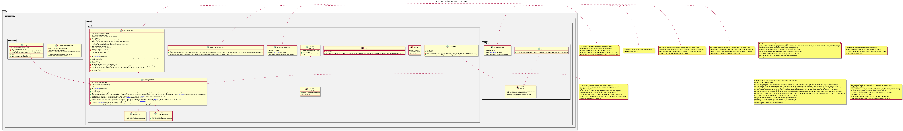

:PROPERTIES:
:ID: 57182ECE-6364-421A-A46F-73841F9961B4
:ores.cpp.service-app.enabled: nil
:END:
#+title: ores.marketdata.service
#+description: NATS service entrypoint for the market-data domain.
#+type: ores.codegen.component
#+component_kind: service
#+level: cross
#+filetags: :marketdata:service:component:
#+created: 2026-05-19
#+updated: 2026-05-19
#+name: marketdata.service
#+full_name: ores.marketdata.service
#+brief: Market data ingestion and query service

* Diagram

#+attr_html: :width 100% :alt ores.marketdata.service component diagram
#+caption: ores.marketdata.service

* Summary

=ores.marketdata.service= is the NATS service entrypoint for the market-data
domain. It opens database and NATS connections, registers handlers from
=ores.marketdata.core=, and runs the event loop.

* Inputs

- Configuration file: NATS server URL, PostgreSQL connection string.
- NATS request messages for market-data operations.

* Outputs

- A running NATS service for market-data operations.

* Entry points

- =src/main.cpp=, =src/app/=, =src/config/=.

* Dependencies

- =ores.marketdata.core=, =ores.marketdata.api=, =ores.logging=, =nats.c=.

* Build dependencies

What the shared profile cannot know, declared here rather than
hand-edited into the generated build file. Each block is spliced
into its generated file after the profile's baseline.

* See also

- [[id:759530D8-2314-44F3-A50E-71CE7AD02558][ores.marketdata.core]] — all market-data business logic.

* Test dependencies

The suites link what the profile cannot know about.

#+begin_src cmake :name extra_dependencies
target_link_libraries(${lib_target_name}
    PUBLIC
        ores.service.lib
        ores.security.lib
        ores.marketdata.core.lib
        ores.refdata.core.lib
        ores.nats.lib
        ores.database.lib
        ores.utility.lib
        ores.telemetry.core.lib
        ores.eventing.core.lib
        ores.iam.client.lib
        ores.analytics.quant.lib
        ores.inbox.api.lib
        ores.inbox.core.lib)
#+end_src

#+begin_src cmake :name extra_test_dependencies
target_link_libraries(${tests_target_name}
    PRIVATE
        ${lib_target_name}
        ores.utility.lib
        ores.testing.lib
        ores.logging.lib
        ores.iam.api.lib
        ores.iam.core.lib
        ores.inbox.api.lib
        ores.inbox.core.lib
        Catch2::Catch2
        faker-cxx::faker-cxx
        Threads::Threads)
#+end_src
