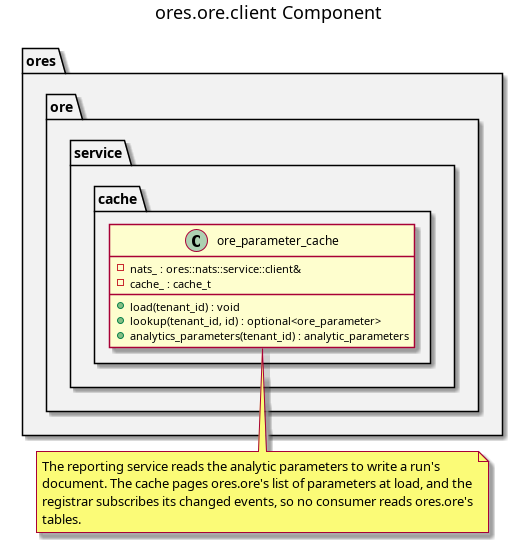

:PROPERTIES:
:ID: 29867179-096C-42BA-ACDC-929A0FF8372F
:END:
#+title: ores.ore.client
#+description: Consumer-side helpers for ORE's description: the tenant cache of ore parameters, loaded over NATS.
#+type: ores.codegen.component
#+header_only: true
#+level: cross
#+filetags: :ore:client:component:
#+created: 2026-11-23
#+updated: 2026-11-23
#+name: ore.client
#+full_name: ores.ore.client
#+brief: ORE client

* Diagram

#+attr_html: :width 100% :alt ores.ore.client component diagram
#+caption: ores.ore.client

* Summary

=ores.ore.client= is a header-only library that lets a service read ORE's
description without reading =ores.ore='s tables. It hosts the
=ore_parameter_cache=: an in-process, per-tenant cache of the ore parameters,
loaded over NATS from =ores.ore='s list operation and reloaded on their changed
events. Its registrar wires the warm-up and the changed-event subscription at
service start. The reporting service reads the analytic parameters from it to
write a run's document, and the trading service reads the instrument fields to
describe a product, so the cache lives here rather than in either of them. A
load carries a bearer token, so a consumer passes a token provider.

* Inputs

- Domain types from =ores.ore.api=: =ore_parameter=.
- NATS protocol messages from =ores.ore.api=: the ore parameter list
  request and response, and the =ore_parameter_event=.

* Outputs

- C++ headers with the tenant cache and its registrar.

* Entry points

- =service/cache/ore_parameter_cache.hpp= — =load()=, =lookup()=, and the
  views a consumer needs, such as =analytics_parameters()=.
- =service/cache/ore_parameter_cache_registrar.hpp= —
  =warm_and_subscribe_ore_parameter_cache()=.

* Dependencies

- =ores.ore.api= — the domain and protocol types.
- =ores.eventing= — the changed-event types and the =partitioned_cache=
  primitive.
- =ores.nats= — the service client and subscription type.
- =ores.logging= — logger setup.

* Build dependencies

What the shared profile cannot know, declared here rather than
hand-edited into the generated build file. Each block is spliced
into its generated file after the profile's baseline.

#+begin_src cmake :name extra_dependencies
target_link_libraries(${lib_target_name}
    INTERFACE
        ores.nats.lib
        ores.ore.api.lib
        ores.eventing.api.lib
        ores.eventing.core.lib
        ores.logging.lib
        ores.utility.lib)
#+end_src

* Test dependencies

The suites link what the profile cannot know about.

#+begin_src cmake :name extra_test_dependencies
target_link_libraries(${tests_target_name}
    PRIVATE
        ores.ore.client.lib
        ores.telemetry.core.lib
        ores.utility.lib
        ores.testing.lib
        Catch2::Catch2
        ores.openssl_cleanup
        Threads::Threads)
#+end_src

* See also

- [[id:723B0112-4DDC-4C03-924E-2C90C2F19B5C][Placement of entity-mirror caches]] — why a cache with more than one
  consumer lives in a =client= component.
- [[id:C32C4A3B-1B34-4A4A-A71D-62F25AA874E7][ores.refdata.client]] — the same shape for reference data.
