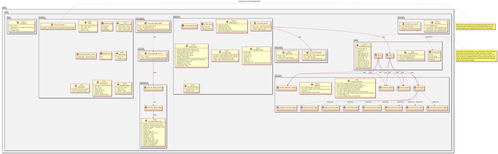

:PROPERTIES:
:ID: 9A71F1F5-C3ED-4C07-9D7D-C5B42D4A1332
:END:
#+title: ores.ore.core
#+name: ore.core
#+full_name: ores.ore.core
#+description: The ORE document engine — XSD-generated XML bindings, instrument mappers, the importer, exporter and round trip, the market data readers, and the import planner and scanner.
#+type: ores.codegen.component
#+component_kind: core
#+hidden_visibility: true
#+level: cross
#+filetags: :ore:core:component:
#+created: 2026-05-19
#+updated: 2026-09-26
#+brief: ORE document engine

* Diagram

#+attr_html: :width 100% :alt ores.ore.core component diagram
#+caption: ores.ore.core

* Summary

=ores.ore.core= is the engine that moves ORE documents in and out of the
ORES domain model. It holds the codec that reads and writes ORE's XML
vocabulary, the projections and mappers between the codec's records and the
=ores.trading=, =ores.refdata= and =ores.analytics= domain types, the importer, the exporter
and the directory round trip, readers for ORE's market data text formats,
the import planner and directory scanner, and the generated series key
shape entity with its repository.

The record tables are generated from the vendored schemas by
=projects/ores.ore/scripts/regenerate_xml_bindings.sh=, and a drift check
fails when the committed tables differ from what the schemas produce.

* Inputs

- ORE XML documents read from disk: portfolios, currency configurations,
  calendar adjustments and conventions.
- ORE market data text files (=-market*.txt=, =fixings*.txt=) and the
  =oresmd= series keys they carry.
- ORES trading and reference data objects to serialise back to ORE XML.

* Outputs

- Trading domain objects: trades with their instruments and envelopes,
  plus mapped conventions and FX conventions.
- Reference data objects: currencies, calendar adjustments, portfolios
  and books.
- Regenerated ORE XML documents, mirrored by the round trip.

* Entry points

- =include/ores.ore.core/domain/= — the projections and the mappers.
- =include/ores.ore.core/xml/= — the importer, the exporter and the round trip.
- =include/ores.ore.core/market/= — the ORE market data readers and the FX
  quote convention checker.
- =include/ores.ore.core/scanner/= — the directory walk that classifies ORE
  files by root element.
- =include/ores.ore.core/planner/= — the import plan and its choices.
- =include/ores.ore.core/hierarchy/= — the portfolio and book node builder.
- =include/ores.ore.core/log/= — the ORE engine log line parser.
- =include/ores.ore.core/xml/run_package.hpp= — where an ORE input directory's
  files sit in the directory the engine reads.

* Dependencies

- =ores.ore.api= — the shared contract, linked publicly.
- =ores.refdata.api=, =ores.trading.api=, =ores.analytics.api= and
  =ores.reporting.api= — the domain types the mappers and projections target,
  linked publicly.
- =ores.dq.api=, =ores.logging=, =ores.platform=, =ores.utility= and Boost — linked
  privately.

The component holds no database session. It converts documents and returns
types; the store that once wrote reporting, refdata and analytics rows lived
here and was removed, because a format codec that opens a session is a codec
that writes another component's tables.

XML parsing is the generated binding code. The component links =pugixml=
for the documents it writes and does not link =nats.c=.

* Build dependencies

What the shared profile cannot know, declared here rather than
hand-edited into the generated build file. Each block is spliced
into its generated file after the profile's baseline.

* See also

- [[id:0F93B352-F234-4D9D-82E6-05218BE645E8][ores.ore.api]] — the shared contract and the entity protocol.
- [[id:EF8FD20D-0B9C-4379-8BBD-B4FCF2F5F0C7][ores.ore.service]] — the runnable host.
- [[id:5F280C8C-8C50-40A2-8C84-C85B8821D33E][ores.ore]] — the composite this part belongs to.
- [[id:F9AE7F54-D995-476A-BA24-93698BF5029D][ORE market data catalogue]] — the market data files this part reads.
- [[id:DF2B616F-E112-4C57-A73B-69F85BE96EF4][Market data architecture]] — where the readers sit in the wider flow.
- [[id:A3B7C9E1-4F2D-8A6B-5E1C-9D3F7A0B2E4C][ORE model configuration]] — the configuration files this part parses.
- [[id:7302A9A4-8B64-4C92-8582-49FB5A2219A2][How do I round trip an ORE document through the database?]] — the live path for the same documents.
- [[id:1CBDEA40-5FAE-4F04-BD21-2BB29172B5AA][Open Source Risk Engine (ORE)]] — the upstream engine.

* CMake

The generated record tables and the larger projections are big translation
units, and MSVC needs /bigobj for them. The flag predates the codec and stays
until a Windows build shows it is not needed.

#+begin_src cmake :name cmake_finalize :implements FDEE629F-F8BA-4940-AA1B-6671AF332D82
if(MSVC)
    target_compile_options(${lib_target_name} PUBLIC /bigobj)
endif()
#+end_src

* Test dependencies

The suites link what the profile cannot know about.

#+begin_src cmake :name extra_dependencies
target_link_libraries(${lib_target_name}
    PUBLIC
        ores.analytics.api.lib
        ores.ore.api.lib
        ores.refdata.api.lib
        ores.reporting.api.lib
        ores.trading.api.lib
    PRIVATE
        ores.dq.api.lib
        ores.logging.lib
        ores.platform.lib
        ores.utility.lib
        pugixml::pugixml
        Boost::boost)
#+end_src

#+begin_src cmake :name extra_test_dependencies
target_link_libraries(${tests_target_name}
    PRIVATE
        ${lib_target_name}
        ores.utility.lib
        ores.platform.lib
        ores.testing.lib
        ores.analytics.api.lib
        ores.analytics.core.lib
        ores.reporting.api.lib
        ores.reporting.core.lib
        ores.refdata.api.lib
        ores.refdata.core.lib
        ores.logging.lib
        ores.eventing.api.lib
        ores.eventing.core.lib
        ores.nats.lib
        ores.openssl_cleanup
        Catch2::Catch2
        faker-cxx::faker-cxx
        Threads::Threads)

# The corpus tests read the ORE examples from the checkout and write their
# output where a validator can reach it. Both paths are compile-time constants
# so a test run needs no environment beyond the tree it was built from.
target_compile_definitions(${tests_target_name} PRIVATE
    ORES_SOURCE_DIR="${CMAKE_SOURCE_DIR}"
    ORES_XML_ROUNDTRIP_DIR="${CMAKE_BINARY_DIR}/xml-roundtrip")
#+end_src
