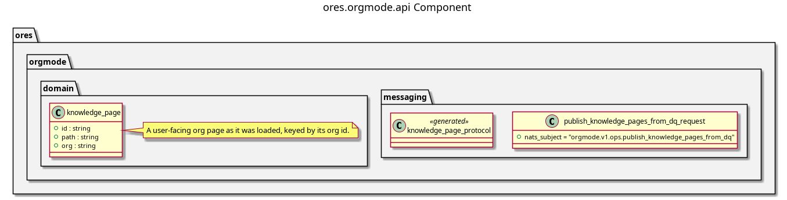

:PROPERTIES:
:ID: B99097A3-F6C4-427F-B97A-6E220ABA18DB
:ores.cpp.scaffold.enabled: true
:END:
#+title: ores.orgmode.api
#+description: Messages of the knowledge service: load, index, search and read a knowledge page.
#+type: ores.codegen.component
#+level: cross
#+filetags: :orgmode:knowledge:component:
#+created: 2026-11-21
#+updated: 2026-11-21
#+name: orgmode.api
#+full_name: ores.orgmode.api
#+brief: Knowledge service messages
#+component_kind: api
#+hidden_visibility: true

* Diagram

#+attr_html: :width 100% :alt ores.orgmode.api component diagram
#+caption: ores.orgmode.api

* Summary

=ores.orgmode.api= holds the messages of the knowledge service: loading the
knowledge pages, indexing them, searching their sections and reading a page by
its org id. It is empty until the knowledge search story's tasks add them; see
[[id:05FE6068-3CBD-4B93-B6AE-47A5689F1FCB][Search the knowledge base from ores.web]].

* Inputs

-

* Outputs

-

* Entry points

-

* Dependencies

#+begin_src cmake :name extra_dependencies
target_link_libraries(${lib_target_name}
    PUBLIC
        ores.platform.lib
    PRIVATE
        ores.utility.lib)
#+end_src

#+begin_src cmake :name extra_test_dependencies
target_link_libraries(${tests_target_name}
    PRIVATE
        ${lib_target_name}
        ores.utility.lib
        ores.testing.lib
        ores.logging.lib
        Catch2::Catch2
        faker-cxx::faker-cxx
        Threads::Threads)
#+end_src

* See also

-
