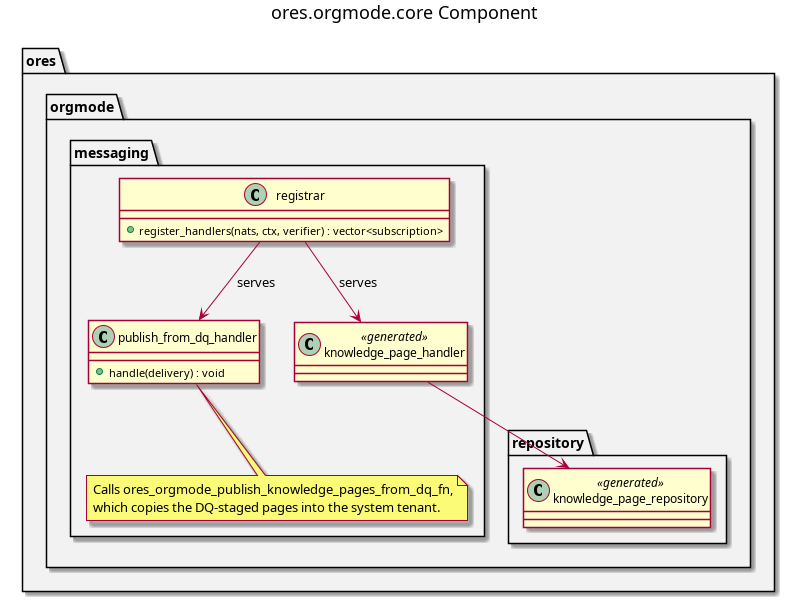

:PROPERTIES:
:ID: F55EBC5D-5A0B-433E-A6DC-858D82AE8020
:ores.cpp.scaffold.enabled: true
:END:
#+title: ores.orgmode.core
#+description: The knowledge base's tables: the knowledge pages published from DQ, their repository, and the search over them.
#+type: ores.codegen.component
#+level: cross
#+filetags: 
#+created: 2026-11-21
#+updated: 2026-11-21
#+name: orgmode.core
#+full_name: ores.orgmode.core
#+brief: Knowledge pages tables and repository

* Diagram

#+attr_html: :width 100% :alt ores.orgmode.core component diagram
#+caption: ores.orgmode.core

* Summary

(Three to five sentences: what this component does and why it exists.)

* Inputs

-

* Outputs

-

* Entry points

-

* Dependencies

-

* See also

-
