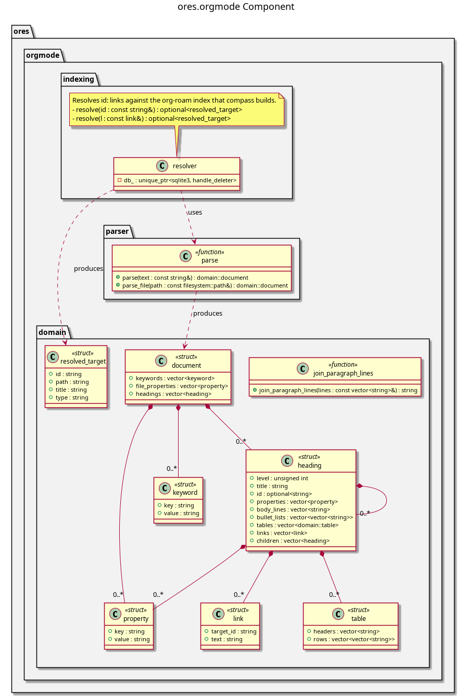

:PROPERTIES:
:ID: E93FA0E8-3439-4CDC-B092-4B02C530AA10
:END:
#+title: ores.orgmode
#+description: Org-mode in ORE: the parser, and the knowledge service that loads, indexes and searches ORE's org pages.
#+type: ores.codegen.component
#+level: cross
#+filetags: :orgmode:knowledge:component:
#+created: 2026-11-21
#+updated: 2026-11-21
#+name: orgmode
#+full_name: ores.orgmode
#+brief: Org-mode parsing and the knowledge service
#+component_kind: composite
#+parts: parser service

* Diagram

#+attr_html: :width 100% :alt ores.orgmode component diagram
#+caption: ores.orgmode

* Summary

=ores.orgmode= is org-mode in ORE. =ores.orgmode.parser= parses org pages
into documents and resolves =id:= links; =ores.orgmode.service= is the
knowledge service, which will load ORE's org pages, index them into sections
and answer searches and page reads. Its =api= and =core= parts are added by the
tasks that give them their first messages and tables. The service parts are
built by [[id:05FE6068-3CBD-4B93-B6AE-47A5689F1FCB][Search the knowledge base from ores.web]].

* Inputs

-

* Outputs

-

* Entry points

-

* Dependencies

-

* See also

-
