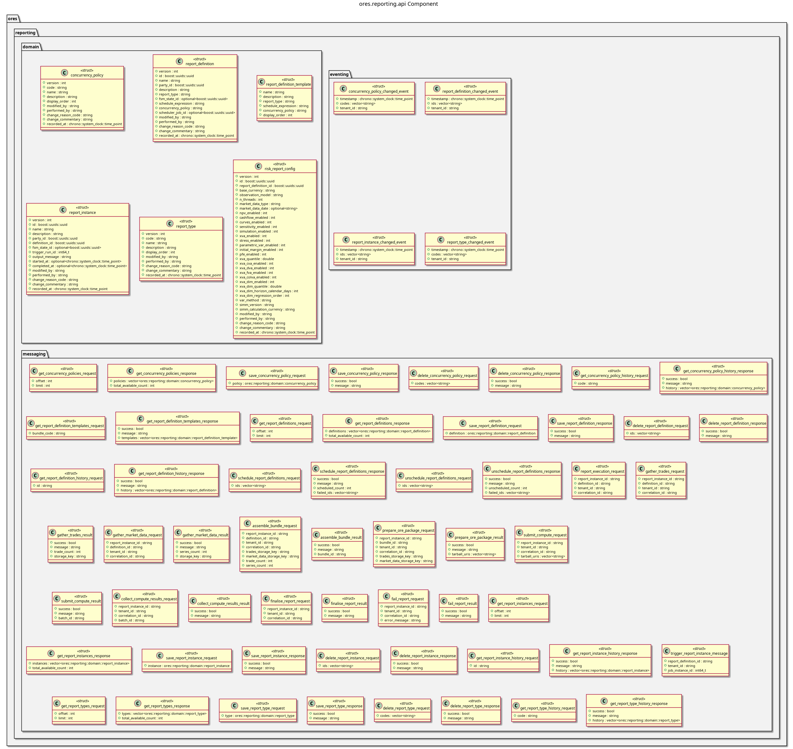

:PROPERTIES:
:ID: E5AC5738-0694-494E-823E-0322F4902AD2
:END:
#+title: ores.reporting.api
#+name: reporting.api
#+full_name: ores.reporting.api
#+description: Domain types and NATS protocol schemas for the reporting component.
#+brief: Reporting domain types and NATS protocol schemas
#+type: ores.codegen.component
#+component_kind: api
#+level: cross
#+filetags: :reporting:api:component:
#+created: 2026-05-19
#+updated: 2026-05-19

* Diagram

#+attr_html: :width 100% :alt ores.reporting.api component diagram
#+caption: ores.reporting.api

* Summary

=ores.reporting.api= is a header-only library defining the shared contract for
the reporting domain. It provides domain types for report types, definitions,
instances, concurrency policies, and run status values, together with JSON
and table I/O via =rfl=, and the NATS protocol schemas consumed by
=ores.reporting.core= and UI clients.

* Inputs

- Domain entity type definitions: report type, definition, instance, concurrency
  policy headers.

* Outputs

- C++ headers for all reporting domain types with JSON and table I/O.
- NATS protocol headers for report management operations.

* Entry points

- =include/ores.reporting.api/domain/= — all domain entity headers.
- =include/ores.reporting.api/messaging/= — NATS protocol message headers.

* Dependencies

- =rfl= — JSON serialisation via reflection.
- =fort= — formatted table rendering.

* Build dependencies

What the shared profile cannot know, declared here rather than
hand-edited into the generated build file. Each block is spliced
into its generated file after the profile's baseline.

* See also

- [[id:F1B83A47-E029-4D78-9A56-31B7CFE49265][ores.reporting]] — component group overview.

- [[id:D65B6932-7A33-471C-98C6-6AC345D4684C][ores.reporting.core]] — business logic, persistence, and NATS handlers.
- [[id:B1A5C952-B709-444B-8A63-5FD834D87D52][ores.reporting Messaging Reference]] — full NATS subject and message catalogue.

* Test dependencies

The suites link what the profile cannot know about.

#+begin_src cmake :name extra_dependencies
target_link_libraries(${lib_target_name}
    PUBLIC
        ores.eventing.api.lib
        ores.platform.lib
        ores.workflow.api.lib
    PRIVATE
        ores.utility.lib
        faker-cxx::faker-cxx
        libfort::fort)
#+end_src

#+begin_src cmake :name extra_test_dependencies
target_link_libraries(${tests_target_name}
    PRIVATE
        ores.reporting.api.lib
        ores.telemetry.core.lib
        ores.utility.lib
        ores.testing.lib
        faker-cxx::faker-cxx
        Catch2::Catch2
        ores.openssl_cleanup
        Threads::Threads)
#+end_src
