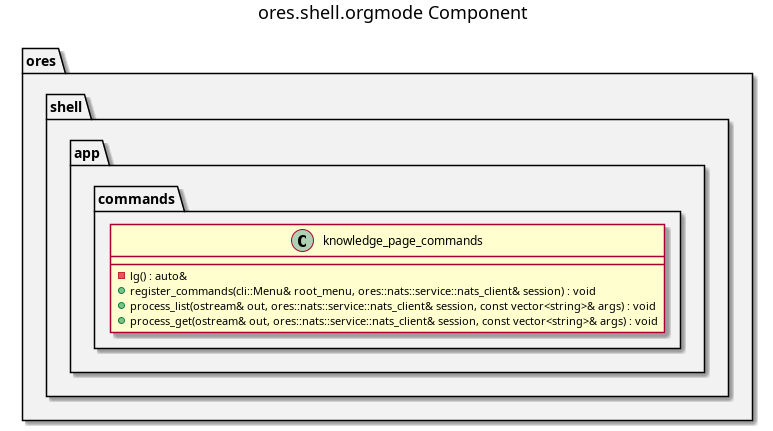

:PROPERTIES:
:ID: 2F481DEB-205B-4075-B036-3E261B75A02A
:END:
#+title: ores.shell.orgmode
#+description: The shell's orgmode adapter part. Holds the generated command unit that lists and reads the knowledge pages from the REPL.
#+type: ores.codegen.component
#+component_kind: adapter
#+level: cross
#+filetags: :shell:repl:orgmode:knowledge:component:
#+created: 2026-11-21
#+updated: 2026-11-21
#+name: orgmode
#+full_name: ores.shell.orgmode
#+brief: Shell knowledge page command units

* Diagram

#+attr_html: :width 100% :alt ores.shell.orgmode component diagram
#+caption: ores.shell.orgmode

* Summary

=ores.shell.orgmode= is the adapter part that projects the knowledge base onto
the shell's REPL. It holds one unit, =knowledge_page_commands=, generated from
[[id:932F96AD-9A59-4B06-8452-901E3B5C5F52][ores.orgmode.knowledge_page]]. It
lists the knowledge pages the system tenant holds and reads one by its org id,
over NATS, so the loaded pages can be checked by hand before the search exists.

* Inputs

- The entity model the generated unit comes from.
- The live session, which carries the request to =ores.orgmode.service=.

* Outputs

- A =knowledge_pages= submenu: =list= and =get=.

* Entry points

- =include/ores.shell/app/commands/orgmode/knowledge_page_commands.hpp= — the
  generated =knowledge_pages= submenu, registered by the REPL.

* Dependencies

- [[id:367BFE0C-8B08-4F0B-B2F7-1DECCC65816D][ores.orgmode.api]] — the protocol
  the generated unit speaks.
- =ores.shell.api= — the shared command helpers.

* See also

- [[id:D0876A24-69BA-F484-ED9B-71CD3AA8710C][ores.shell]] — the component group overview.
- [[id:05FE6068-3CBD-4B93-B6AE-47A5689F1FCB][Search the knowledge base from ores.web]] — the story that loads and searches the pages.

#+begin_src cmake :name extra_dependencies
find_package(cli CONFIG REQUIRED)

target_link_libraries(${lib_target_name}
    PUBLIC
        ores.shell.api.lib
        ores.nats.lib
        ores.logging.lib
    PRIVATE
        ores.orgmode.api.lib
        ores.platform.lib
        ores.utility.lib)
#+end_src

#+begin_src cmake :name extra_test_dependencies
target_link_libraries(${tests_target_name}
    PRIVATE
        ${lib_target_name}
        ores.testing.lib
        Catch2::Catch2
        ores.openssl_cleanup
        Threads::Threads)
#+end_src
