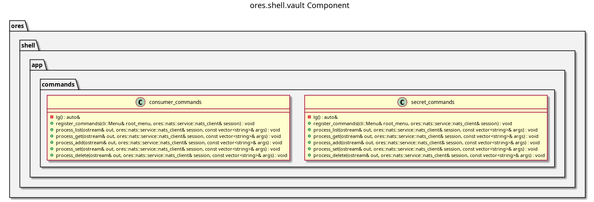

:PROPERTIES:
:ID: 493ED620-FF12-4935-939C-0D139F0648B1
:END:
#+title: ores.shell.vault
#+description: The vault projected into the shell: the secrets and consumers a person maintains from the command line.
#+type: ores.codegen.component
#+level: cross
#+filetags: :shell:vault:component:
#+created: 2026-11-26
#+updated: 2026-11-26
#+name: shell.vault
#+full_name: ores.shell.vault
#+brief: Vault shell commands

* Diagram

#+attr_html: :width 100% :alt ores.shell.vault component diagram
#+caption: ores.shell.vault

* Summary

=ores.shell.vault= projects the vault into the command line: a person lists,
adds and reads the secrets and consumers their tenant keeps. The commands speak
the vault's own protocol through the shell's request machinery, so the shell
carries no custody logic of its own and the value it writes is sealed before it
leaves the client.

* Inputs

- The arguments a person types, and the tenant and party the session runs in.
- The vault's protocol, through the shell's request helpers.

* Outputs

- Requests on the vault's subjects, and the tables and feedback a person reads.

* Entry points

- =include/ores.shell/app/commands/vault/secret_commands.hpp= — the secrets menu.
- =include/ores.shell/app/commands/vault/consumer_commands.hpp= — the consumers menu.

* Dependencies

- =ores.vault.api= — the protocol and the domain types.
- =ores.shell.api= — the menu, argument and feedback machinery every shell part uses.

* See also

-

#+begin_src cmake :name extra_dependencies
find_package(cli CONFIG REQUIRED)

target_link_libraries(${lib_target_name}
    PUBLIC
        ores.shell.api.lib
        ores.nats.lib
        ores.logging.lib
    PRIVATE
        ores.vault.api.lib
        ores.platform.lib
        ores.utility.lib
        cli::cli)
#+end_src
