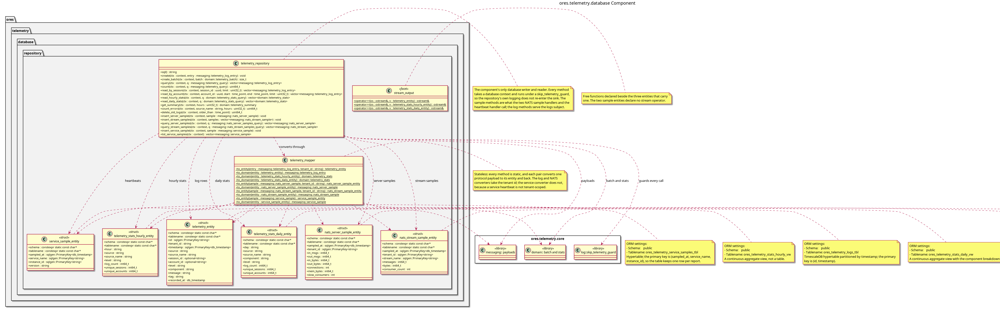

:PROPERTIES:
:ID: B73EAF3C-1384-4882-9310-8E9DB594C038
:END:
#+title: ores.telemetry.database
#+name: telemetry.database
#+full_name: ores.telemetry.database
#+description: Database persistence layer for telemetry log records.
#+brief: Telemetry log record persistence layer
#+type: ores.codegen.component
#+level: cross
#+filetags: :telemetry:database:component:
#+created: 2026-05-19
#+updated: 2026-05-19

* Diagram

#+attr_html: :width 100% :alt ores.telemetry.database component diagram
#+caption: ores.telemetry.database

* Summary

=ores.telemetry.database= is the PostgreSQL persistence layer for telemetry
log records. It provides ORM entities, mappers, and repositories for storing
=log_record= objects (trace_id, span_id, severity, message, service identity)
in the =ores_telemetry= schema, used by =ores.telemetry.service= when
persisting received records.

* Inputs

- =log_record= objects forwarded from =ores.telemetry.service=.
- PostgreSQL connections to =ores_telemetry_*= tables.

* Outputs

- Log records persisted to the =ores_telemetry= schema for querying via the
  telemetry UI.

* Entry points

- =include/ores.telemetry.database/= — ORM entity and repository headers.

* Dependencies

- =ores.telemetry.core= — domain types (log_record, resource).
- =ores.dq= — ORM base classes.
- =soci= — SQL ORM for PostgreSQL persistence.

* Build dependencies

What the shared profile cannot know, declared here rather than
hand-edited into the generated build file. Each block is spliced
into its generated file after the profile's baseline.

#+begin_src cmake :name extra_dependencies
target_link_libraries(${lib_target_name}
    PUBLIC
        ores.database.lib
        ores.telemetry.core.lib
    PRIVATE
        Boost::boost)
#+end_src

* See also

- [[id:8A2B3C4D-5E6F-7A8B-9C0D-1E2F3A4B5C6D][ores.telemetry.core]] — observability library that produces log records.
- [[id:DF0CAAB9-9DDB-4FEA-82D3-71FAC2177EEF][ores.telemetry.service]] — service that calls this persistence layer.

* CMake

This part reads headers from ores.telemetry.core and ores.logging directly.

#+begin_src cmake :name cmake_finalize :implements FDEE629F-F8BA-4940-AA1B-6671AF332D82
target_include_directories(${lib_target_name} PUBLIC
    ${CMAKE_SOURCE_DIR}/projects/ores.telemetry/core/include
    ${CMAKE_SOURCE_DIR}/projects/ores.logging/include)
#+end_src

* Test dependencies

The suites link what the profile cannot know about.

#+begin_src cmake :name extra_test_dependencies
target_link_libraries(${tests_target_name} PRIVATE
    ores.telemetry.core.lib
    ores.utility.lib
)
#+end_src
