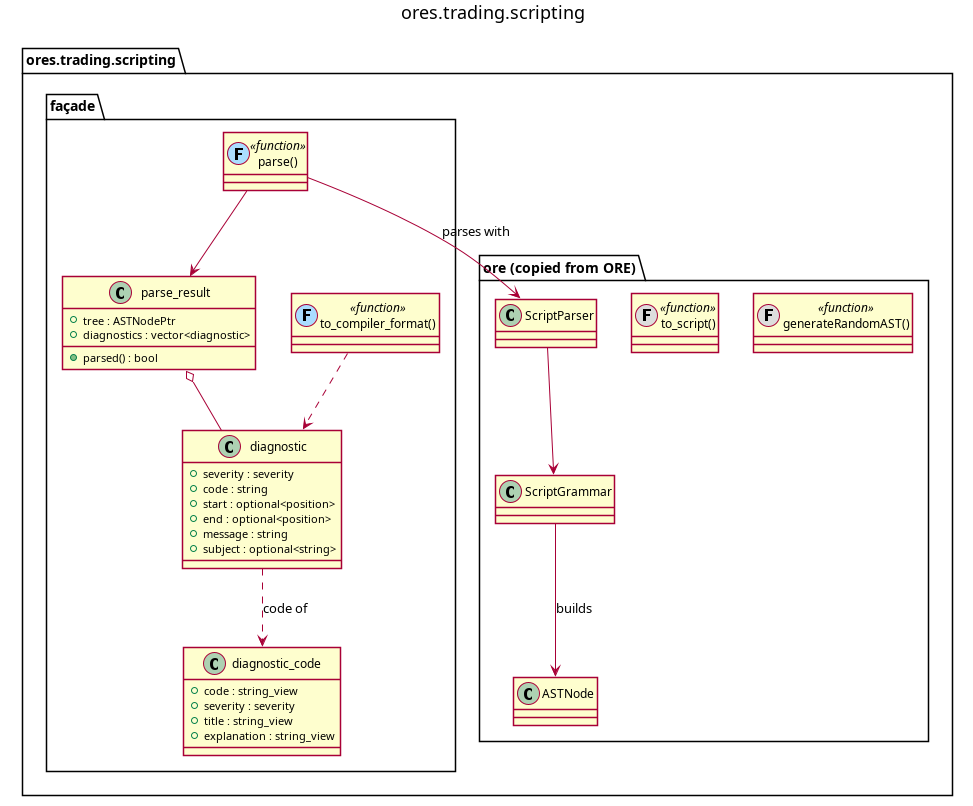

:PROPERTIES:
:ID: 3861DA99-704C-4CEB-84EC-B829E2BDD2B0
:END:
#+title: ores.trading.scripting
#+description: ORE's payoff script grammar, syntax tree and parser, copied from ORE, with diagnostics; no database, messaging or QuantLib.
#+type: ores.codegen.component
#+level: cross
#+filetags: :trading:scripting:component:
#+created: 2026-11-21
#+updated: 2026-11-21
#+name: trading.scripting
#+full_name: ores.trading.scripting
#+brief: ORE script parser and diagnostics
#+test_fixture: none

* Diagram

#+attr_html: :width 100% :alt ores.trading.scripting component diagram
#+caption: ores.trading.scripting

* Summary

The payoff script grammar of ORE, reproduced so that ORE Studio judges a script
exactly as ORE does. The grammar, the syntax tree, the parser, the printer, the
conversion of a tree back to script text and the random syntax tree generator are
copied from ORE's =OREData/ored/scripting= by an import script, which applies a
fixed set of mechanical transforms and records the ORE commit; the same script
fails when the copy differs from what it would produce. Around the copy, a façade
in ORE Studio's style parses a script and reports its findings as diagnostics.
The component carries no database, messaging or QuantLib dependency, and knows
no trading type, so that every other component that reads scripts may depend on
it without a cycle, as [[id:4E135FB5-6E0A-45CC-A805-F5B70F29DDB4][Component Architecture of the Scripted Trade Subsystem]]
describes; its grammar is the one authority described in
[[id:8FD7BD95-AAEC-4CF9-A9F4-D609A9DEFBD8][Script Parsing with ORE's Grammar]].

* Inputs

- The text of a payoff script.

* Outputs

- A syntax tree, or the diagnostics of a script that does not parse, located by
  line and column as [[id:ECA442BB-48D7-47CB-9BAA-97FD1C0BBA9A][Diagnostic Reporting in Script Validation]] defines.
- A script's text, printed from a syntax tree.
- A script's inputs, derived from its syntax tree.

* Entry points

- =ores::trading::scripting::parse= — parses a script, returning its tree or its
  diagnostics.
- =ores::trading::scripting::inputs_of= — the inputs of one variant of a script:
  the variables it reads and neither declares nor assigns, with the type its use
  implies, whether it is an array, and the rule its REQUIRE statements state.
- =ores::trading::scripting::merge_inputs= — the inputs of a script with several
  variants, the first variant's first.
- =ores::trading::scripting::ast_to_script= — prints a tree as script text.
- =ores::trading::scripting::print_ast= — prints a tree's structure.
- =ores::trading::scripting::generate_random_ast= — writes a random tree, for
  tests that compare grammars.

* Dependencies

- =Boost::boost=, for Spirit Qi and Phoenix, which are header-only.
- Deliberately not linked: QuantLib, =ores.database=, =ores.nats=, and every
  trading type.

* Build dependencies

What the shared profile cannot know, declared here rather than hand-edited into
the generated build file. Each block is spliced into its generated file after
the profile's baseline.

* See also

- [[id:5C7A961E-D834-4B2F-AE15-F049B27361D8][ores.trading]] — component group overview.
- [[id:FD34A3B5-0E24-467A-A9D7-A2F2E7480E1B][ores.trading.api]] — the domain types, builders and protocol of the trading domain.
- [[id:4E135FB5-6E0A-45CC-A805-F5B70F29DDB4][Component Architecture of the Scripted Trade Subsystem]] — the place of this component in the subsystem.

#+begin_src cmake :name extra_dependencies
target_link_libraries(${lib_target_name}
    PUBLIC
        Boost::boost)
#+end_src

#+begin_src cmake :name extra_test_dependencies
target_link_libraries(${tests_target_name}
    PRIVATE
        ${lib_target_name}
        Catch2::Catch2
        Threads::Threads)
#+end_src
