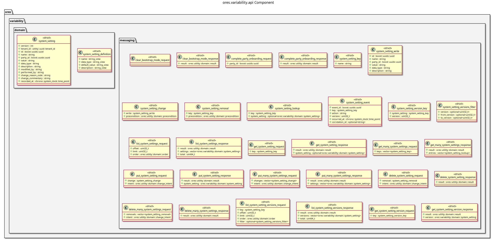

:PROPERTIES:
:ID: 26218AD6-C63E-44E8-9B92-7FB51C366566
:END:
#+title: ores.variability.api
#+name: variability.api
#+full_name: ores.variability.api
#+description: Domain types and NATS protocol schemas for the variability component.
#+brief: Variability domain types and NATS protocol schemas
#+type: ores.codegen.component
#+component_kind: api
#+level: cross
#+filetags: :variability:api:component:
#+created: 2026-05-19
#+updated: 2026-05-19

* Diagram

#+attr_html: :width 100% :alt ores.variability.api component diagram
#+caption: ores.variability.api

* Summary

=ores.variability.api= is a header-only library defining the shared contract
for the variability domain. It provides domain types for system settings
(=system_setting=, =system_settings=) with JSON and table I/O, and the NATS
protocol schemas for the variability subject hierarchy. Both
=ores.variability.core= and consumer components depend on this library.

* Inputs

- Domain entity type definitions: =system_setting.hpp=, =system_settings.hpp=.
- NATS protocol message definitions.

* Outputs

- C++ headers for variability domain types with JSON and table I/O.
- NATS protocol headers for setting query and update operations.
- Aggregate header: =ores.variability.api.domain.hpp=.

* Entry points

- =include/ores.variability.api/domain/= — all domain entity headers.
- =include/ores.variability.api/messaging/= — NATS protocol message headers.

* Dependencies

- =rfl= — JSON serialisation via reflection.
- =fort= — formatted table rendering.

* Build dependencies

What the shared profile cannot know, declared here rather than
hand-edited into the generated build file. Each block is spliced
into its generated file after the profile's baseline.

* See also

- [[id:1EE1B07C-3EC4-9BC4-1C4B-5BD458A8B2E5][ores.variability.core]] — business logic, persistence, and NATS handlers.
- [[id:E4D5F6A7-B8C9-0123-DEFA-234567890123][ores.variability Messaging Reference]] — full NATS subject and message catalogue.

* Test dependencies

The suites link what the profile cannot know about.

#+begin_src cmake :name extra_dependencies
target_link_libraries(${lib_target_name}
    PUBLIC
        ores.eventing.api.lib
        ores.platform.lib
    PRIVATE
        ores.utility.lib
        faker-cxx::faker-cxx
        libfort::fort)
#+end_src

#+begin_src cmake :name extra_test_dependencies
target_link_libraries(${tests_target_name}
    PRIVATE
        ores.variability.api.lib
        ores.telemetry.core.lib
        ores.utility.lib
        ores.testing.lib
        faker-cxx::faker-cxx
        Catch2::Catch2
        Threads::Threads)
#+end_src
