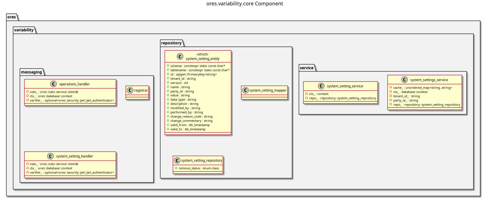

:PROPERTIES:
:ID: 1EE1B07C-3EC4-9BC4-1C4B-5BD458A8B2E5
:END:
#+title: ores.variability.core
#+name: variability.core
#+full_name: ores.variability.core
#+description: System variability and configuration management — feature flags, settings, and temporal change tracking.
#+brief: Feature flag and settings configuration core
#+type: ores.codegen.component
#+component_kind: core
#+hidden_visibility: true
#+level: cross
#+filetags: :variability:core:component:
#+created: 2026-05-19
#+updated: 2026-05-19

* Diagram

#+attr_html: :width 100% :alt ores.variability.core component diagram
#+caption: ores.variability.core

* Summary

=ores.variability.core= manages system-wide configuration and runtime
variability for ORE Studio. It stores feature flags and system settings in the
database with bitemporal versioning (so any configuration change can be audited
and rolled back), and exposes NATS handlers for querying and updating settings
at runtime. Other components depend on this library to drive runtime-
configurable behaviour without redeployment.

* Inputs

- NATS request messages for setting query/update operations.
- PostgreSQL connections to the =ores_variability_*= tables with temporal
  versioning.

* Outputs

- System-setting records persisted to the =ores_variability= schema with
  bitemporal history.
- NATS response messages returned to callers.

* Entry points

- =include/ores.variability.core/ores.variability.hpp= — aggregate include.
- =include/ores.variability.core/messaging/registrar.hpp= — registers NATS
  handlers with the service host.
- =include/ores.variability.core/service/= — setting management services.
- =include/ores.variability.core/repository/= — ORM entities and mappers.

* Dependencies

- =ores.variability.api= — shared domain types and NATS protocol schemas.
- =ores.dq= — ORM base classes.
- =rfl= — JSON serialisation via reflection.
- =soci= — SQL ORM for PostgreSQL persistence.
- =nats.c= — NATS messaging client.

* Build dependencies

What the shared profile cannot know, declared here rather than
hand-edited into the generated build file. Each block is spliced
into its generated file after the profile's baseline.

* See also

- [[id:26218AD6-C63E-44E8-9B92-7FB51C366566][ores.variability.api]] — protocol types and domain entities.
- [[id:95D9E246-27ED-440F-B14A-481A546B7C4F][ores.variability.service]] — NATS service entrypoint.
- [[id:E4D5F6A7-B8C9-0123-DEFA-234567890123][ores.variability Messaging Reference]] — full NATS subject and message catalogue.

* Test dependencies

The suites link what the profile cannot know about.

#+begin_src cmake :name extra_dependencies
target_link_libraries(${lib_target_name}
    PUBLIC
        ores.variability.api.lib
        ores.database.lib
        ores.logging.lib
        ores.nats.lib
    PRIVATE
        ores.service.lib
        ores.utility.lib
        ores.security.lib
        ores.dq.api.lib
        ores.history.core.lib
        ores.diff.lib
        ores.eventing.core.lib
        faker-cxx::faker-cxx
        libfort::fort
        Boost::boost)
#+end_src

#+begin_src cmake :name extra_test_dependencies
target_link_libraries(${tests_target_name}
    PRIVATE
        ${lib_target_name}
        ores.telemetry.core.lib
        ores.utility.lib
        ores.logging.lib
        ores.service.lib
        ores.eventing.api.lib
        ores.eventing.core.lib
        ores.refdata.core.lib
        ores.diff.lib
        ores.testing.lib
        ores.openssl_cleanup
        Catch2::Catch2
        faker-cxx::faker-cxx
        Threads::Threads)
#+end_src
