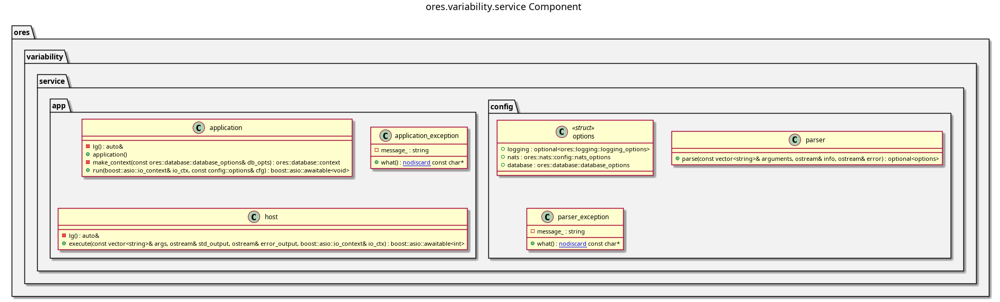

:PROPERTIES:
:ID: 95D9E246-27ED-440F-B14A-481A546B7C4F
:ores.cpp.service-app.enabled: nil
:END:
#+title: ores.variability.service
#+description: NATS service entrypoint for the variability domain.
#+type: ores.codegen.component
#+component_kind: service
#+level: cross
#+filetags: :variability:service:component:
#+created: 2026-05-19
#+updated: 2026-05-19
#+name: variability.service
#+full_name: ores.variability.service
#+brief: Feature flags and runtime configuration service

* Diagram

#+attr_html: :width 100% :alt ores.variability.service component diagram
#+caption: ores.variability.service

* Summary

=ores.variability.service= is the NATS service entrypoint for the variability
domain. It reads configuration, opens database and NATS connections, registers
all message handlers from =ores.variability.core=, and runs the event loop.
All business logic lives in =ores.variability.core=.

* Inputs

- Configuration file: NATS server URL, PostgreSQL connection string, and
  environment settings.
- NATS request messages for system-setting queries and updates.

* Outputs

- A running NATS service handling all variability operations.
- NATS response messages returned to callers.
- Structured logs via =ores.logging=.

* Entry points

- =src/main.cpp= — process entry point.
- =src/app/= — application bootstrap and dependency injection.
- =src/config/= — configuration parsing and validation.

* Dependencies

- =ores.variability.core= — all NATS handlers, repositories, and services.
- =ores.variability.api= — shared protocol types.
- =ores.logging= — structured logging infrastructure.
- =nats.c= — NATS client for connection management.

* Build dependencies

What the shared profile cannot know, declared here rather than
hand-edited into the generated build file. Each block is spliced
into its generated file after the profile's baseline.

* See also

- [[id:1EE1B07C-3EC4-9BC4-1C4B-5BD458A8B2E5][ores.variability.core]] — all business logic for the variability domain.

* Test dependencies

The suites link what the profile cannot know about.

#+begin_src cmake :name extra_dependencies
target_link_libraries(${lib_target_name}
    PUBLIC
        ores.service.lib
        ores.security.lib
        ores.variability.core.lib
        ores.nats.lib
        ores.database.lib
        ores.utility.lib
        ores.telemetry.core.lib
        ores.eventing.core.lib
        ores.eventing.api.lib)

target_link_libraries(${exe_target_name}
    PRIVATE
        ${lib_target_name}
        ores.openssl_cleanup
        Threads::Threads)
#+end_src

#+begin_src cmake :name extra_test_dependencies
target_link_libraries(${tests_target_name}
    PRIVATE
        ${lib_target_name}
        ores.utility.lib
        ores.testing.lib
        ores.logging.lib
        Catch2::Catch2
        faker-cxx::faker-cxx
        Threads::Threads)
#+end_src
