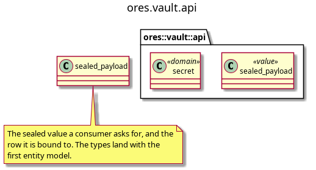

:PROPERTIES:
:ID: 85B593E6-8F46-47FE-9805-1A02EB599585
:END:
#+title: ores.vault.api
#+description: Domain types, sealed payloads and the NATS protocol of the vault.
#+type: ores.codegen.component
#+component_kind: api
#+hidden_visibility: true
#+level: cross
#+filetags: :vault:api:component:
#+created: 2026-11-26
#+updated: 2026-11-26
#+name: vault.api
#+full_name: ores.vault.api
#+brief: Vault domain types and protocol

* Diagram

#+attr_html: :width 100% :alt ores.vault.api component diagram
#+caption: ores.vault.api

* Summary

The vault's contracts: the domain type of a secret as a consumer sees it, the
sealed payload a resolve answers with, and the request and response of each of
the five custody operations. The generated CRUD subjects of the two entities sit
beneath them, and the serve task replaces them with the custody five. The part
holds no database and no bus, so the service, the client and any other caller
share one vocabulary without linking each other's logic.

* Inputs

- A sealed payload to write, and the tenant and owner it belongs to.
- The name, and optionally the version, of a secret to resolve.

* Outputs

- The protocol types of =vault.v1.secrets.*= and =vault.v1.consumers.*=, which
  the generated CRUD baseline carries today, and the five =vault.v1.ops.*=
  subjects the serve task adds.
- The sealed payload a resolve carries, and the metadata a describe answers.

* Entry points

- =include/ores.vault.api/ores.vault.api.hpp= — the aggregate include.

* Dependencies

- =ores.eventing.api= and =ores.platform=, which every api part links so that a
  state change can be announced. Nothing else, which is what lets every other
  part depend on this one.

* See also

- [[id:F27E5DF7-6223-4B6F-80A5-CEFBEB1BC756][Component architecture]] — the =api= role.
