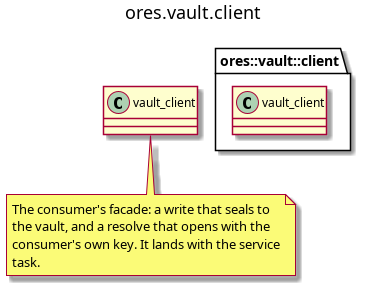

:PROPERTIES:
:ID: B08524D0-B321-462B-AA0D-2ACD74A9C436
:ores.cpp.scaffold.enabled: true
:END:
#+title: ores.vault.client
#+description: The consumer's facade: sealed writes and resolves over NATS.
#+type: ores.codegen.component
#+level: cross
#+filetags: :vault:client:component:
#+created: 2026-11-26
#+updated: 2026-11-26
#+name: vault.client
#+full_name: ores.vault.client
#+brief: Vault client facade

* Diagram

#+attr_html: :width 100% :alt ores.vault.client component diagram
#+caption: ores.vault.client

* Summary

The consumer's side. It seals a write to the vault's transport key, and it
opens a resolve with the consumer's own private key, so a service asks for a
secret without linking the vault's logic or the key encryption key.

* Inputs

- The vault's transport public key, which is not a secret.
- The consumer's own private key, from its system credential.
- A name, a plaintext to write, and the tenant.

* Outputs

- The plaintext of a resolved secret, in memory.
- The metadata of a secret, and the acknowledgement of a write.

* Entry points

- =include/ores.vault.client/client/credential_bootstrap.hpp= — the exchange a
  workload makes before it holds any token.
- =include/ores.vault.client/domain/stub.hpp= — the placeholder the generated
  baseline carries.
- The facade that seals a write and opens a resolve arrives with the serve task.

* Dependencies

- =ores.nats= — the request and reply.
- =ores.security= — =sealed_box=, to seal a write and open a resolve.
- =ores.vault.api= — the types.

* Build dependencies

What the shared profile cannot know, declared here rather than hand-edited into
the generated build file. Each block is spliced into its generated file after
the profile's baseline.

#+begin_src cmake :name extra_dependencies
target_link_libraries(${lib_target_name}
    PUBLIC
        ores.vault.api.lib
    PRIVATE
        ores.nats.lib
        ores.security.lib
        ores.logging.lib
        ores.utility.lib)
#+end_src

#+begin_src cmake :name extra_test_dependencies
target_link_libraries(${tests_target_name}
    PRIVATE
        # The test stands in for the vault: it seals the nonce and the value
        # with the transport key, so the exchange is proved against a party
        # that answers the protocol rather than against a mock.
        ores.security.lib
        ores.nats.lib)
#+end_src

* See also

- [[id:4F28F755-7DA1-4EDD-9983-256622B6088A][Sealed Delivery of a Secret to Its
  Consumer]] — what the facade carries out.
