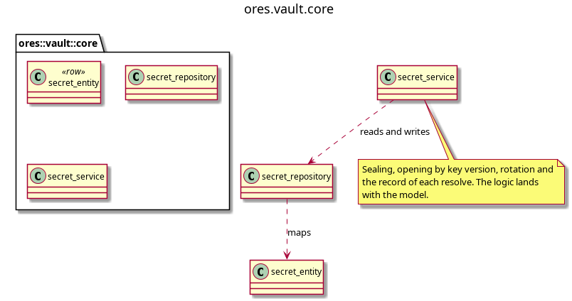

:PROPERTIES:
:ID: 8DBBDF68-9CE9-4341-AB6D-3982E8242BAC
:END:
#+title: ores.vault.core
#+description: The sealed secret store, its key versions and the audit of each resolve.
#+type: ores.codegen.component
#+component_kind: core
#+level: cross
#+filetags: :vault:core:component:
#+created: 2026-11-26
#+updated: 2026-11-26
#+name: vault.core
#+full_name: ores.vault.core
#+brief: Vault logic and repository

* Diagram

#+attr_html: :width 100% :alt ores.vault.core component diagram
#+caption: ores.vault.core

* Summary

The store: the repository over the secret rows, the sealing of a value under
the current key version, the rotation that re-wraps every row, and the record of
each resolve. It owns the binding between a value and its row, and it decides no
policy, because the permission code arrives already checked.

* Inputs

- A sealed payload from a write, opened with the vault's transport key.
- The name and tenant of a resolve, and the caller's subject from the request
  context.

* Outputs

- The stored row, its key version and its audit tail.
- A sealed answer, sealed to the caller's registered public key.
- One audit record per resolve.

* Entry points

- =include/ores.vault.core/ores.vault.core.hpp= — the aggregate include.
- =include/ores.vault.core/service/secret_service.hpp= — sealing, opening and
  rotation.

* Dependencies

- =ores.security= — =sealed_box= for the transport and =secret_sealer= for the
  row.
- =ores.database= — the pool and the unit of work.
- =ores.vault.api= — the types and the protocol.

* See also

- [[id:F9F1A2BA-94C2-4DAA-8689-F0871AA56801][Secret Custody in the Vault]] — the key's home and the boundary with IAM.

#+begin_src cmake :name extra_dependencies
target_link_libraries(${lib_target_name}
    PRIVATE
        ores.database.lib
        # compass:except(core_link_edges/forbidden_edge) expires=2027-11-26 approver=marco reason=the history provider every entity registers needs the shared dispatch registry, and the codegen baseline does not carry the link
        ores.history.core.lib)
#+end_src

#+begin_src cmake :name extra_test_dependencies
target_link_libraries(${tests_target_name}
    PRIVATE
        ores.eventing.core.lib)
#+end_src
