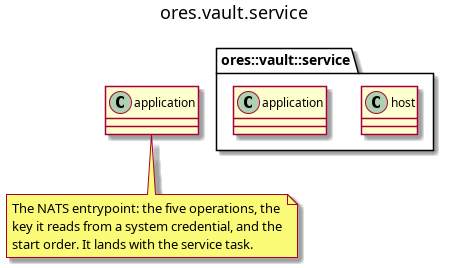

:PROPERTIES:
:ores.cpp.service-app.enabled: nil
:ores.cpp.service-app.config_options_header.enabled: true
:ores.cpp.service-app.config_options_impl.enabled: true
:ores.cpp.service-app.config_parser_header.enabled: true
:ores.cpp.service-app.config_parser_impl.enabled: true
:ores.cpp.service-app.config_parser_exception.enabled: true
:ID: 33941A34-E3CB-47E9-91F5-0ADB8305DD96
:END:
#+title: ores.vault.service
#+description: The vault's NATS entrypoint: the five operations and the key it loads at start.
#+type: ores.codegen.component
#+component_kind: service
#+level: cross
#+filetags: :vault:service:component:
#+created: 2026-11-26
#+updated: 2026-11-26
#+name: vault.service
#+full_name: ores.vault.service
#+brief: Vault service entrypoint

* Diagram

#+attr_html: :width 100% :alt ores.vault.service component diagram
#+caption: ores.vault.service

* Summary

The runnable host. It reads the key encryption key and its own transport key
from system credentials, wires the database and the bus, and serves the five
operations to callers that pass the runner's token check. The unit is the only
process that opens a stored secret.

It also carries the deployment's own write. Run with =--provision=, it reads one
document from a file or a pipe, registers the consumers the deployment states and
stores the values it states for them, then exits without opening a subscription.
That is the one act on the vault no caller authenticates, and it exists because
the first value a deployment stores is the password of the service that issues
the tokens a write would otherwise need.

* Inputs

- NATS requests on =vault.v1.ops.*=, carrying the caller's token.
- The two system credentials, which the unit reads at start.
- The database, through the pool.
- The provisioning document, on standard input or in a file, when =--provision=
  is given.

* Outputs

- Responses, in which only a resolve carries a value and only in sealed form.
- The audit rows, through =ores.vault.core=.
- A heartbeat on the fleet's controller.
- One line per provisioned entry, and a non-zero exit when one failed.

* Entry points

- =src/main.cpp= — the entry point.
- =include/ores.vault.service/messaging/secret_event_registrar.hpp= and
  =consumer_event_registrar.hpp= — the registrars the generated baseline
  carries.
- The five custody subjects join them with a registrar of their own, which the
  serve task adds beside these.
- =include/ores.vault.service/app/provisioning.hpp= — the deployment's write:
  the document it reads and the act that applies it.

* Dependencies

- =ores.vault.core=, =ores.nats=, =ores.service=, =ores.database=.

* Options
:PROPERTIES:
:group: Provisioning
:END:

The options this service takes beyond logging, NATS and the database. Codegen
writes the member, its wire field, its command-line declaration and its
assignment from each entry.

** provision
:PROPERTIES:
:cpp_type: std::string
:option: provision
:default: ""
:help: Write the consumers and secrets a JSON document names, then exit; "-" reads standard input
:END:

The document a deployment writes once, before any service holds a token: the
consumers whose keys it registers and the values it stores for them. Empty
starts the service as usual.

* See also

- [[id:8ECCBD02-21F5-455C-B520-193E4631092F][Anatomy of a Service]] — every
  layer a working service needs.

#+begin_src cmake :name extra_dependencies
target_link_libraries(${lib_target_name}
    PUBLIC
        ores.eventing.core.lib
        # The provisioning document is JSON, read once by the deployment's own
        # step rather than carried by the bus.
        Boost::json)
#+end_src

#+begin_src cmake :name extra_test_dependencies
target_link_libraries(${tests_target_name}
    PRIVATE
        # The document reader's cases build their documents in memory, so the
        # suite needs the parser the reader uses and nothing else.
        Boost::json)
#+end_src
