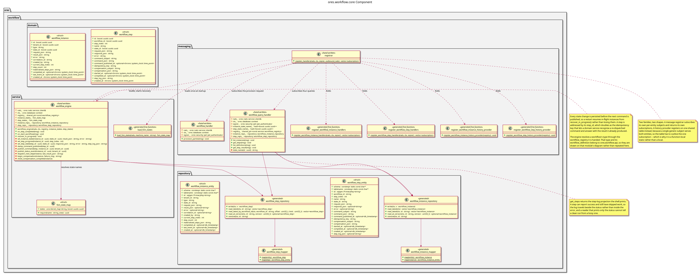

:PROPERTIES:
:ID: 440294D7-385D-41EE-92CB-CAB937E65E81
:END:
#+title: ores.workflow.core
#+name: workflow.core
#+full_name: ores.workflow.core
#+description: Workflow orchestration — workflow definitions, execution, and state tracking for multi-step operations.
#+brief: Workflow definition and execution core
#+type: ores.codegen.component
#+component_kind: core
#+level: cross
#+filetags: :workflow:core:component:
#+created: 2026-05-19
#+updated: 2026-05-19

* Diagram

#+attr_html: :width 100% :alt ores.workflow.core component diagram
#+caption: ores.workflow.core

* Summary

=ores.workflow.core= provides workflow orchestration for ORE Studio. It manages
workflow definitions (sequences of steps with preconditions and actions),
execution instances (tracking progress and current state), and exposes NATS
handlers for workflow management. Workflows coordinate multi-step operations
such as report generation pipelines that span multiple services.

* Inputs

- NATS request messages for workflow definition CRUD and execution management.
- PostgreSQL connections to =ores_workflow_*= tables.

* Outputs

- Workflow definition and execution records persisted to the =ores_workflow=
  schema.
- NATS response messages returned to callers.

* Entry points

- =include/ores.workflow.core/ores.workflow.core.hpp= — aggregate include.
- =include/ores.workflow.core/messaging/registrar.hpp= — registers handlers.

* Dependencies

- =ores.workflow.api= — shared domain types and NATS protocol schemas.
- =ores.dq= — ORM base classes and persistence infrastructure.
- =ores.iam.core= — identity and authorisation context.
- =rfl= — JSON serialisation.
- =soci= — SQL ORM.
- =nats.c= — NATS messaging client.

* Build dependencies

What the shared profile cannot know, declared here rather than
hand-edited into the generated build file. Each block is spliced
into its generated file after the profile's baseline.

* See also

- [[id:7F4B91E2-3D86-4A57-B92C-08E146DA7359][ores.workflow]] — component group overview.

- [[id:85319483-4AE9-4162-91F7-D72A8201134B][ores.workflow.api]] — protocol types and domain entities.
- [[id:1AF4AEC8-70EC-496C-821E-4E2E1BB303E5][ores.workflow.service]] — NATS service entrypoint.

* Test dependencies

The suites link what the profile cannot know about.

#+begin_src cmake :name extra_dependencies
target_link_libraries(${lib_target_name}
    PUBLIC
        ores.workflow.api.lib
    PRIVATE
        ores.database.lib
        ores.utility.lib
        ores.service.lib
        ores.nats.lib
        ores.history.core.lib
        ores.dq.api.lib
        ores.dq.core.lib
        ores.iam.api.lib
        ores.ore.api.lib
        ores.refdata.api.lib
        ores.reporting.api.lib
        ores.telemetry.core.lib
        sqlgen::sqlgen
        Boost::boost)
#+end_src

#+begin_src cmake :name extra_test_dependencies
target_link_libraries(${tests_target_name}
    PRIVATE
        ${lib_target_name}
        ores.database.lib
        ores.eventing.api.lib
        ores.eventing.core.lib
        ores.nats.lib
        ores.security.lib
        ores.utility.lib
        ores.testing.lib
        ores.logging.lib
        Catch2::Catch2
        faker-cxx::faker-cxx
        ores.openssl_cleanup
        Threads::Threads)
#+end_src
